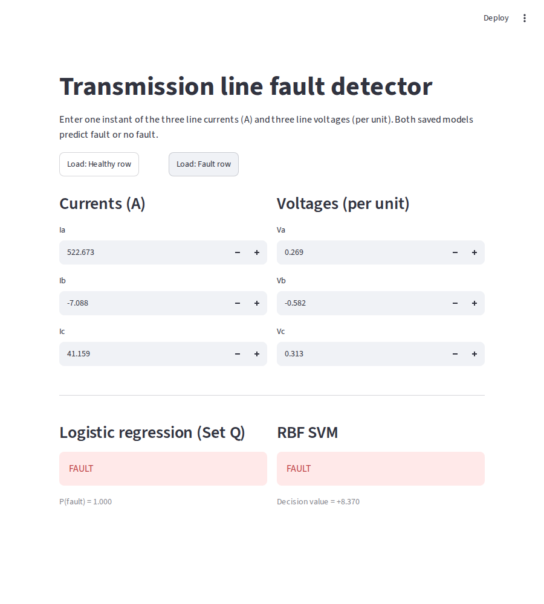
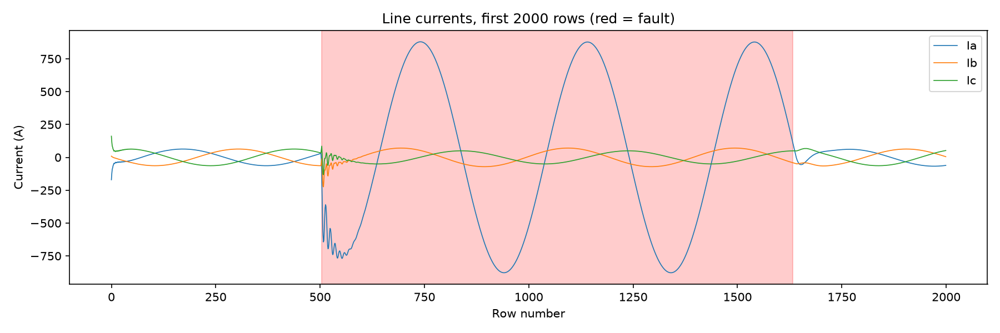
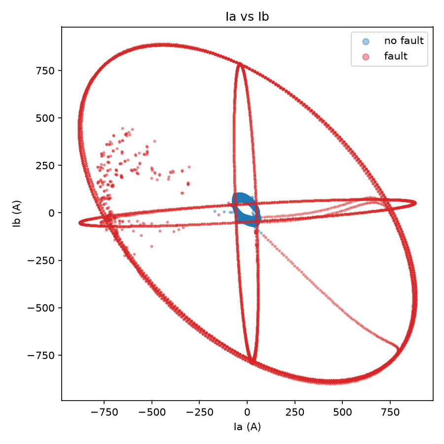
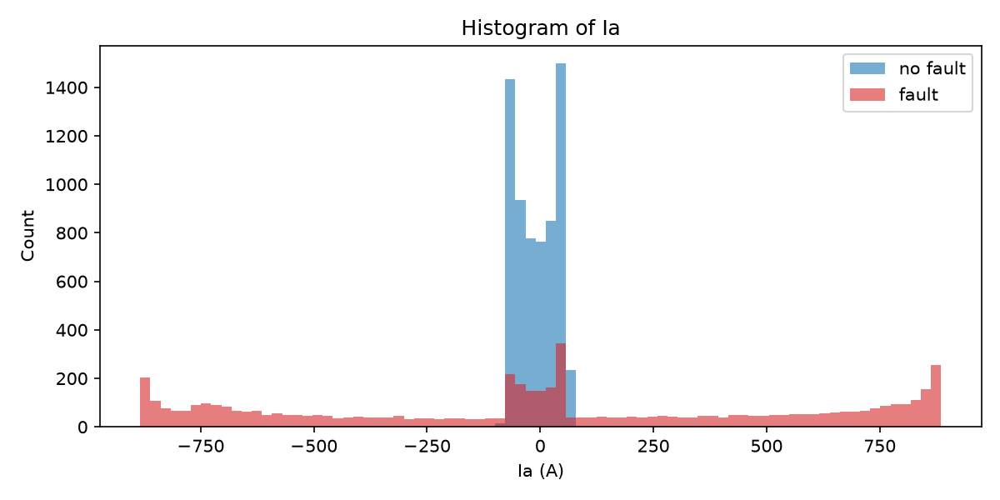
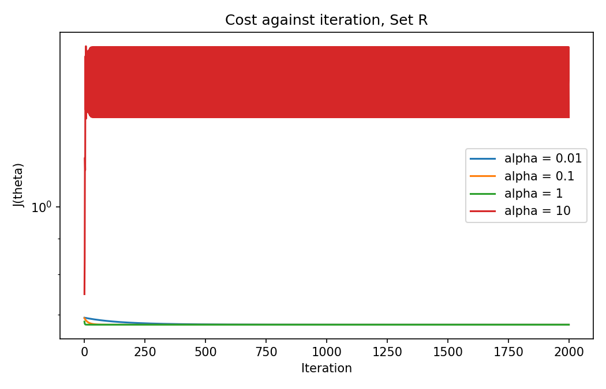
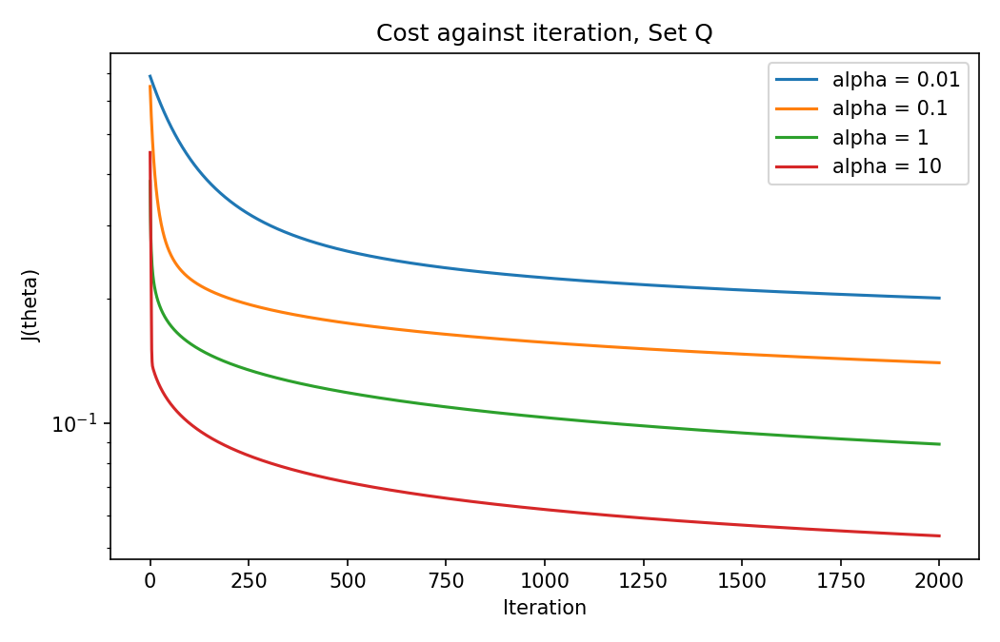
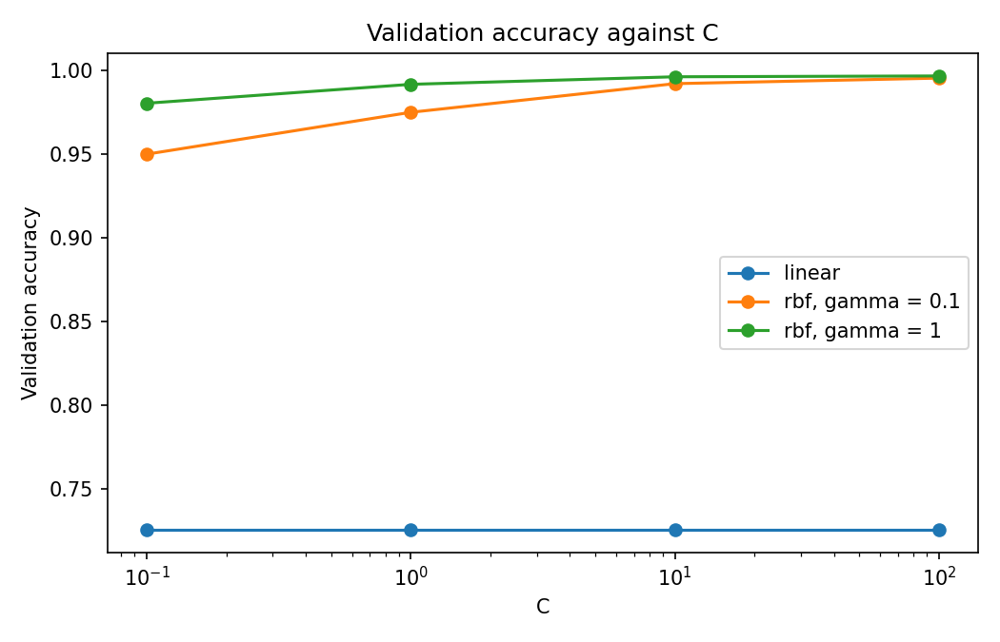

# Fault Detection on a Three-Phase Transmission Line

Can a straight-line decision boundary detect a fault from raw instantaneous current and voltage measurements? If not, is the simplest fix new features or a new classifier?

This project classifies one instant of three line currents (Ia, Ib, Ic) and three line voltages (Va, Vb, Vc) as **fault (1)** or **no fault (0)**. Logistic regression is written by hand in NumPy, and the support vector machines (linear and RBF kernel) use `sklearn.svm.SVC` only. A Streamlit app compares two saved models side by side.

Course project for **AI4003 Applied Machine Learning** (Fall 2026), FAST-NUCES.


## Key results

| Model | Test accuracy | False alarms | Missed faults |
|---|---|---|---|
| Logistic regression, Set R (6 raw features) | 72.6% | 0 | 657 |
| Logistic regression, Set Q (raw + squares, 12 features) | 97.9% | 6 | 45 |
| Linear SVM (C = 0.1) | 73.6% | 0 | 634 |
| RBF SVM (C = 100, γ = 1) | **99.6%** | 4 | **6** |

The test set has 2,401 rows (1,096 faults). It was used once, after every choice (α, C, γ) was made on the validation set.

**Findings**

- A single straight line on raw measurements does not work. Both linear models reach only about 73% and miss more than half of the faults, because a faulted current is still a sine wave that crosses zero and looks healthy at some instants.
- Adding the squares of the six measurements lifts logistic regression to 97.9%. The squared current weights are positive and the squared voltage weights are negative, matching a current surge and a voltage sag.
- The RBF SVM is best at 99.6% with only 6 missed faults, so it is the model we would deploy.
- Test accuracy is probably optimistic. The rows are consecutive time samples but the split is random, so 84.5% of test rows have a direct neighbour in the training set.

The full tables, figures and written answers to all analysis questions are in [`results/analysis.md`](results/analysis.md).

## Project structure

```
data/        detect_dataset.csv
src/         load_data.py, prepare.py, eda.py, logistic.py, metrics.py,
             train_logistic.py, train_svm.py, test_models.py
results/     tables/, figures/, models/, analysis.md
app/         app.py
```

| File | Purpose |
|---|---|
| `src/load_data.py` | Reads the raw CSV exactly as stored |
| `src/prepare.py` | Task 1: cleaning, 60/20/20 split (seed 42), standardisation with training statistics |
| `src/eda.py` | Task 2: three exploratory plots |
| `src/logistic.py` | Sigmoid, hypothesis, cost, batch gradient descent, predict |
| `src/metrics.py` | Accuracy and confusion matrix, written by hand |
| `src/train_logistic.py` | Task 3: α search, cost curves, final models |
| `src/train_svm.py` | Task 4: linear and RBF SVM grid, saved models |
| `src/test_models.py` | Task 5: one-time evaluation on the test rows |
| `app/app.py` | Task 7: Streamlit front end |

## Setup

Tested with Python 3.12.

```bash
pip install -r requirements.txt
```

The dataset is already in `data/detect_dataset.csv`. If it is missing, download `detect_dataset.csv` from the [Kaggle dataset](https://www.kaggle.com/datasets/esathyaprakash/electricalfault-detection-and-classification) and place it in `data/`.

## Run everything

Run every command from the repository root, in this order:

| Step | Command | What it does |
|---|---|---|
| Check loader | `python src/load_data.py` | Prints shape, columns and first 5 rows |
| Task 1 | `python src/prepare.py` | Cleaning report and split summary |
| Task 2 | `python src/eda.py` | Three exploratory plots |
| Task 3 | `python src/train_logistic.py` | α search, cost plots, accuracy, θ |
| Task 4 | `python src/train_svm.py` | SVM table, accuracy against C plot, saved SVMs |
| Task 5 | `python src/test_models.py` | Test accuracy, confusion matrices, missed faults |
| Task 7 | `streamlit run app/app.py` | Web app at http://localhost:8501 |

Tasks 3 and 4 must run before Task 5 and the app, because they save the models. Plots go to `results/figures/`, CSV tables to `results/tables/`, and models and θ to `results/models/`.

## Front end

Type the six values or press one of the two example buttons. The app shows the Set Q logistic regression and the RBF SVM side by side, with the probability of fault for the first and the decision value for the second. It warns when the two models disagree.



## Figures

**Exploratory plots**





**Choosing α for logistic regression**




**SVM validation accuracy against C**



## Dataset

[Electrical Fault Detection and Classification](https://www.kaggle.com/datasets/esathyaprakash/electricalfault-detection-and-classification) (Kaggle), a three-phase power system simulated in MATLAB/Simulink. Only `detect_dataset.csv` (12,001 rows) is used.
